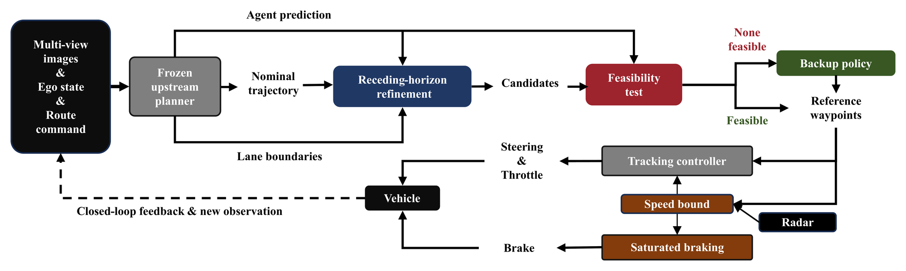

<h1 align="center">CLRE</h1>

<p align="center">
  <b>Closed-Loop Refinement and Execution for Learned Driving Planners</b>
</p>

<p align="center">
  A training-free closed-loop refinement and execution layer for frozen learned driving planners.
</p>

<p align="center">
  <a href="https://arxiv.org/abs/2610.00992"></a>
  <a href="LICENSE"></a>
  
  
  
</p>

<p align="center">
  <a href="#main-results">Results</a> ·
  <a href="#method-and-repository-overview">Method</a> ·
  <a href="#installation">Installation</a> ·
  <a href="#integration">Integration</a> ·
  <a href="#reproducibility">Reproducibility</a> ·
  <a href="#citation">Citation</a>
</p>

---

CLRE sits between a **frozen** learned end-to-end driving planner and the
vehicle. It never retrains or edits that planner. At every control step it
takes the planner's nominal trajectory and its predicted agents, re-solves a
short receding-horizon refinement problem around them, screens the candidates
with a prediction-conditioned oriented-bounding-box (OBB) feasibility test,
and hands the survivor to a safety-aware execution layer. No new learned model
is introduced.

> **Paper** — *Closed-Loop Refinement and Execution for Learned Driving
> Planners*, [arXiv:2610.00992](https://arxiv.org/abs/2610.00992).
>
> **Scope** — this repository is the **method code only**. It deliberately
> does not contain the benchmark, the simulator, the upstream planners, their
> checkpoints, or any experiment output. See
> [Installation](#installation) and [`docs/LICENSE_AUDIT.md`](docs/LICENSE_AUDIT.md).

<p align="center">
  
</p>

<p align="center">
  <i>Overview of CLRE. Gray blocks are supplied unchanged with the upstream
  planner, colored blocks are introduced by CLRE, and dark blocks denote
  sensor inputs and the vehicle.</i>
</p>

## Highlights

* **The upstream planner stays frozen.** CLRE is training-free: no retraining,
  no fine-tuning, no new learned parameters, no edits to the planner.
* **Progress cannot buy predicted contact.** The OBB test is a hard filter
  applied *after* optimisation, so an infeasible candidate can never win on
  the scalar objective, however much progress it promises. This is a
  prediction-conditioned test, not a formal collision-free guarantee.
* **The radar safeguard is prediction-independent.** It consumes only measured
  range and closing rate and does not depend on predicted agent motion, so it
  cannot inherit a prediction defect; it also covers static props absent from
  the planner's agent set entirely. The rest of the execution layer does track
  the selected reference trajectory — the independence claim is about the
  radar safeguard specifically, not the whole layer.
* **"No feasible candidate" is not read as "there is an obstacle".** It means
  the optimiser has nothing to say this tick, so the vehicle follows the
  navigation centerline at its latched entry speed instead of braking. Braking
  on that signal was measured to convert a prediction defect into a stall.
* **Method code only, with the seams documented.** Everything published here
  is the authors' own code; the glue that binds it to each upstream planner is
  specified in [`integration/`](integration/) rather than redistributed.

## Main Results

Closed-loop evaluation on the **full official 220-route Bench2Drive
validation set**, with VAD as the upstream planner. Both arms run the same
frozen checkpoint; they differ only by the CLRE layer.

| Method | Routes | Driving Score ↑ | Route Completion ↑ | Success Rate ↑ | Collisions ↓ |
| :--- | :---: | :---: | :---: | :---: | :---: |
| Native VAD | 220 | 42.26 | 55.69 | 20.91% | 117 |
| **CLRE-VAD** | 220 | **55.89** | **71.51** | **28.64%** | **97** |

**+13.63** Driving Score · **+15.82** Route Completion · **+7.73 pts** Success
Rate · **117 → 97** collision events

Closed-loop runs in this stack are not deterministic, so every comparison in
the paper is paired by route and no single-route difference is interpreted on
its own. The CLRE arm additionally mounts one forward radar for its execution
layer — within the benchmark's four-radar allowance, but it means the two arms
are not sensor-matched. Ablations and the portability arms are in the paper;
see [Reproducibility](#reproducibility) for the protocols.

## Method and Repository Overview

```
CLRE/
├── clre/
│   ├── planning/
│   │   ├── refinement.py            # CLRE core: objective, candidates, OBB test, solver
│   │   └── reference_prototype.py   # offline reference implementation of the objective
│   ├── control/
│   │   ├── radar_safety.py          # forward-radar speed bound
│   │   ├── peb_longitudinal.py      # saturated proportional-error braking
│   │   └── route_centerline.py      # route-centerline backup
│   ├── adapters/
│   │   ├── uniad_adapter.py         # UniAD → CLRE pure data adapter
│   │   └── drivetransformer_adapter.py
│   └── tracing/trace_writer.py      # per-tick npz trace writer
├── integration/                     # how to attach CLRE to each upstream planner
├── docs/                            # reproducibility, parameters, provenance, licence audit
└── tests/                           # offline tests: no CARLA, no checkpoint, no GPU
```

| Component | File | Role |
| :--- | :--- | :--- |
| Receding-horizon refinement | `clre/planning/refinement.py` | 9-term objective, candidate seeds, warm-start buffer, kinematic-bicycle rollout, OBB feasibility test, candidate selection, solver, trace fields. |
| Objective reference | `clre/planning/reference_prototype.py` | Single-candidate-loop implementation of the same objective, kept so the batched solver can be checked against it term by term. |
| Radar speed bound | `clre/control/radar_safety.py` | Constant-deceleration stopping-distance law with corridor/height gating, column-layout self-check and TTC emergency persistence. |
| Proportional braking | `clre/control/peb_longitudinal.py` | Saturated proportional-error braking (PEB-v2) as upstream-free pure functions. |
| Centerline backup | `clre/control/route_centerline.py` | Dense navigation route → ego-frame waypoints. |
| Planner adapters | `clre/adapters/` | Pure data conversion from a planner's raw head outputs to the refinement layer's array schema. |

**Not in this repository, by design:** the benchmark, the simulator, the
upstream planners, any checkpoint, any dataset, and every experiment output
(evaluator results, per-tick traces, CARLA recordings, figures, logs). The
agent wrappers that embed upstream code are described in
[`integration/`](integration/) rather than shipped — see
[`docs/LICENSE_AUDIT.md`](docs/LICENSE_AUDIT.md).

## Supported Upstream Planners

| Planner | Role in the paper | Status |
| :--- | :--- | :--- |
| **VAD** (`Bench2DriveZoo`) | **Main evaluation backbone** — the 220-route result above and all ablations. | Tested end to end. |
| **UniAD** (`Bench2DriveZoo`) | Portability demonstration. | Adapter released; evaluated on a small route subset only. |
| **DriveTransformer-Large** | Portability demonstration. | Adapter released; evaluated on a small route subset only. |

The UniAD and DriveTransformer arms are *portability demonstrations on a small
number of routes*, not full benchmark comparisons, and they are not evidence
of universal generalisation. Do not read them as equivalent evidence to the
VAD results.

## Installation

CLRE itself has almost no dependencies; the heavy stack belongs to the
upstream projects, and this repository points you at them rather than
vendoring them.

**1 — install the upstream stack from its own official sources.**

```bash
# CARLA 0.9.15 — https://github.com/carla-simulator/carla/releases/tag/0.9.15

git clone https://github.com/Thinklab-SJTU/Bench2Drive.git
git -C Bench2Drive checkout 7ec25d1c9f7522d923ce5f3420986cef1cb2d956

git clone https://github.com/Thinklab-SJTU/Bench2DriveZoo.git       # VAD / UniAD
git -C Bench2DriveZoo checkout d9caa0af805ec3c435533aa268e2723d80c20017

# optional, only for the DriveTransformer demonstration:
# https://github.com/Thinklab-SJTU/DriveTransformer
```

Follow each project's own installation instructions — they build a merged
`mmcv`/`mmdet3d` fork and CUDA ops. CLRE adds nothing to that process.

**2 — install CLRE.**

```bash
git clone <this-repository> CLRE
cd CLRE
pip install -r requirements.txt      # numpy, torch, pytest
```

**3 — verify the offline tests.** These need no checkpoint, no simulator and
no GPU:

```bash
python -m pytest tests/ -q
```

**Checkpoints are not distributed here**, and none can be reconstructed from
this repository. Obtain each from its original provider and point the adapters
at your own copies with `CLRE_UNIAD_CKPT` / `CLRE_DT_CKPT`:

| Planner | Checkpoint | Source |
| :--- | :--- | :--- |
| VAD | `vad_b2d_base.pth` | Bench2DriveZoo |
| UniAD | `uniad_base_b2d.pth` | Bench2DriveZoo |
| DriveTransformer | `drivetransformer_large.pth` | DriveTransformer |

The SHA-256 values the paper runs verified are recorded in
[`docs/REPRODUCIBILITY.md`](docs/REPRODUCIBILITY.md) so you can confirm you
have the same weights — they are not download links.

## Integration

CLRE is an **overlay**: keep the upstream repositories unmodified, put
`CLRE/` on `PYTHONPATH`, and add one agent file of your own that subclasses
the upstream agent.

```
<workspace>/
├── Bench2Drive/            # upstream, unmodified
├── Bench2DriveZoo/         # upstream, unmodified
├── CLRE/                   # this repository
└── my_agents/
    └── clre_vad_agent.py   # YOU write this, following integration/vad_integration.md
```

```bash
export PYTHONPATH=/path/to/CLRE:/path/to/Bench2DriveZoo:/path/to/Bench2Drive/leaderboard:$PYTHONPATH
```

The agent file is yours to write because the published version of it embeds
upstream code that the upstream licences do not let us redistribute. Each
guide gives the exact insertion points, the data contract and the invariants
that must hold — everything except the upstream lines you already have:

* [`integration/vad_integration.md`](integration/vad_integration.md) — the main backbone, read this first
* [`integration/uniad_integration.md`](integration/uniad_integration.md)
* [`integration/drivetransformer_integration.md`](integration/drivetransformer_integration.md)
* [`integration/peb_v2_controller_patch.md`](integration/peb_v2_controller_patch.md) — wiring the braking law into the upstream PID controller without touching its steering path

<details>
<summary><b>Per-tick call sequence</b> — three outcomes execute three different trajectories</summary>

<br>

`res.ok` alone does not decide what is driven. A completed solve with no
feasible candidate still returns `ok=True`, and that candidate must not be
executed.

```python
from clre.planning import refinement as clre
from clre.control.radar_safety import RadarSafetyOverride
from clre.control.route_centerline import RouteCenterline

# once, in setup()
cfg  = clre.PlannerConfig(device="cpu", dtype="float64")
clre.apply_fixes(cfg, "r1,r2,r3,geom,feas")   # REQUIRED: see docs/REPRODUCIBILITY.md
warm = clre.WarmBuffer(tick_dt=0.05)
radar        = RadarSafetyOverride()              # measured returns only
centerline   = RouteCenterline.from_agent(self)   # once, from the dense GPS route
hold_speed   = None                               # latched at fallback entry

# ---- every tick, after the upstream forward pass ----
warm.advance()                                 # EVERY tick, before solving
centerline.note_position(pos)                  # EVERY tick, keeps the hint fresh

window = clre.make_window(speed, nominal_plan, route_target_xy,
                          clre.agents_from_arrays(..., fix_r1=cfg.fix_r1),
                          clre.boundaries_from_map(...),
                          v_ref_in=max(clre.native_desired_speed(nominal_plan), 2.5))
res = clre.solve(window, cfg, warm=warm.seed())

exec_plan, exec_source = nominal_plan, "native"      # the default is Native

# ---- stage 1: may the refined plan be adopted at all? ----
if not res.ok:
    # solver failure: non-finite objective/trajectory, or hard-bound
    # violation (res.reason says which). Execute Native, and DROP the warm
    # start -- rejected controls must not seed the next cycle.
    warm.reset()

elif res.solve_ms > cfg.runtime_budget_ms:
    # (3) RUNTIME-BUDGET FAILURE -> Native trajectory.
    #     The solution is numerically valid, it merely arrived late, so it is
    #     DISCARDED for execution but KEPT as the warm start.
    warm.update(res.a, res.k)

else:
    warm.update(res.a, res.k)
    exec_plan, exec_source = res.wp6, "clre"         # (6, 2) waypoints @ 0.5 s

# ---- stage 2: was the adopted plan actually feasible? ----
# res.ok == True does NOT mean a feasible candidate was found: when the OBB
# test rejects every candidate, solve() still returns ok=True and res.wp6
# holds the max-min-clearance candidate. That candidate must NOT be executed.
want_fallback = (exec_source == "clre"
                 and res.sel_mode == "all_infeasible_safest")

if want_fallback and centerline is not None:
    # (2) COMPLETED SOLVE, NO FEASIBLE CANDIDATE -> centerline backup.
    #     Follow the navigation centerline at the ego speed LATCHED at
    #     fallback entry. Never re-read the current speed per tick.
    if hold_speed is None:
        hold_speed = speed
    exec_plan, exec_source = (
        centerline.waypoints_ego(pos, compass_rad, hold_speed), "clre_fallback")
else:
    # (1) FEASIBLE COMPLETED SOLVE -> the refined trajectory already adopted
    #     above, with res.sel_mode == "feasible_best" ("unconstrained" when
    #     the OBB test is disabled, which is not the paper's configuration).
    #     Also reached on the Native-fallback ticks, where nothing is latched.
    hold_speed = None                    # episode over, or never began

# The radar safeguard runs in ALL of the above cases, on measured returns only
speed_cap, radar_tel = radar.evaluate(radar_points, speed)
```

The `centerline is not None` guard is load-bearing: if
`RouteCenterline.from_agent` returned `None` (the dense GPS route was
unavailable), case (2) cannot be served, and the frozen agent then counts a
`centerline_unavailable` event and executes the `all_infeasible_safest`
candidate rather than inventing geometry. Count that event, do not hide it.

</details>

## Reproducibility

| Component | Version / commit |
| :--- | :--- |
| CARLA | 0.9.15 |
| Bench2Drive | `v0.0.4` — `7ec25d1c9f7522d923ce5f3420986cef1cb2d956` |
| Bench2DriveZoo (VAD, UniAD) | `v0.0.4` — `d9caa0af805ec3c435533aa268e2723d80c20017` |
| DriveTransformer | `19702015eb700e804bafb53e63b04571c7b8604a` |
| CLRE frozen research commit | `b1f509df68c427fc128d8b1e7c86520a304c7afb` |
| Python / PyTorch | 3.8 / 1.13 + cu117 (the Bench2DriveZoo environment) |

* **Main protocol** — all 220 routes of
  `Bench2Drive/leaderboard/data/bench2drive_0.0.4_val.xml`, one execution per
  route per arm, 20 Hz control, refinement invoked every tick.
* **Ablation protocol** — the first 36 routes of that same file, in original
  XML order, a cohort fixed before any run.

Full hashes, checkpoint SHA-256 values, route-file hashes, the complete frozen
parameter table and the exact runtime configuration are in
[`docs/REPRODUCIBILITY.md`](docs/REPRODUCIBILITY.md) and
[`docs/PARAMETERS.md`](docs/PARAMETERS.md).

<details>
<summary><b>What this repository can and cannot reproduce</b> — read before relying on it</summary>

<br>

* **Fully reproducible here:** the refinement objective, the candidate
  initialisation and warm start, the OBB test, candidate selection, the
  route-centerline backup, the radar bound, the braking law, and the UniAD /
  DriveTransformer data adapters — together with offline tests that check the
  batched solver against the reference implementation and pin the execution
  layer's behaviour.
* **Reproducible only with upstream components you install yourself:** the
  agent wrappers ([`integration/`](integration/)), and therefore any
  closed-loop run.
* **Not reproducible bit-for-bit by anyone, including us:** closed-loop CARLA
  runs are not deterministic. Repeated executions of identical logic in this
  stack were measured to differ by up to 28 Driving Score on individual
  routes. That is why the paper pairs every comparison by route and interprets
  no single-route difference on its own.

We therefore do **not** claim full end-to-end reproducibility from this
repository alone. Two upstream dependencies carry licence terms that forbid
redistributing modified copies, and one publishes no licence at all, so the
glue code that binds CLRE to them must be reconstructed from the integration
guides in your own checkout.

</details>

<details>
<summary><b>Example evaluation commands</b> — reference only, each needs CARLA, a GPU and a checkpoint</summary>

<br>

Paths, ports and the agent file are yours; see
[`scripts/example_commands.sh`](scripts/example_commands.sh) for the fuller,
guarded version.

```bash
# --- the frozen configuration used for every CLRE arm in the paper ---
export NEWBORN_CANDA_MODE=exec          # execute the refined plan
export NEWBORN_CANDA_DEVICE=cpu         # solver device (paper: CPU, float64)
export NEWBORN_CANDA_DTYPE=float64
export NEWBORN_CANDA_ITERS_COLD=70      # Adam iterations, cold start
export NEWBORN_CANDA_ITERS_WARM=25      # Adam iterations, warm start
export NEWBORN_CANDA_BUDGET_MS=1000.0   # per-tick budget; overrun => use Native plan
export NEWBORN_CANDA_FIXES=r1,r2,r3,geom,feas   # MANDATORY, see below
export NEWBORN_PEBV2=1                  # enable the execution layer

# --- main protocol: the official 220 validation routes ---
python Bench2Drive/leaderboard/leaderboard/leaderboard_evaluator.py \
    --agent=my_agents/clre_vad_agent.py \
    --agent-config=Bench2DriveZoo/adzoo/vad/configs/VAD/VAD_base_e2e_b2d.py \
    --routes=Bench2Drive/leaderboard/data/bench2drive_0.0.4_val.xml \
    --checkpoint=results/clre_vad_official220.json \
    --track=SENSORS --port=2000 --traffic-manager-port=8000

# --- matched baseline: the same routes, upstream planner alone ---
#     (use the stock Bench2DriveZoo agent, unmodified)

# --- ablation protocol: the first 36 routes of the same file ---
#     (same command, restricted to routes 1-36; see docs/REPRODUCIBILITY.md)
```

`NEWBORN_CANDA_FIXES=r1,r2,r3,geom,feas` is **not optional**. With it unset
the refinement layer runs an earlier formulation: no three-disk ego geometry
and, critically, **no OBB feasibility test** (`feas`). Every number in the
paper was produced with all five flags on.

No module in `clre/` reads these variables — they are consumed by the agent
file you write, which passes the values into `PlannerConfig` and
`apply_fixes()` (see [`integration/vad_integration.md`](integration/vad_integration.md) §3).
They keep their frozen research spelling so your runs stay directly comparable
to the published configuration, and so the released modules stay
byte-identical to the evaluated ones; it is not a requirement of the library
itself.

</details>

## Citation

```bibtex
@misc{hu2026clre,
  title         = {Closed-Loop Refinement and Execution for Learned Driving Planners},
  author        = {Hu, Huaijin and Wang, Shanting and Mo, Zhongyu and Malikopoulos, Andreas A.},
  year          = {2026},
  eprint        = {2610.00992},
  archivePrefix = {arXiv}
}
```

Please also cite the upstream work you build on — at minimum CARLA,
Bench2Drive, and the planner you evaluate (VAD, UniAD or DriveTransformer).

## License and Third-Party Notice

The code in this repository is released under the [MIT License](LICENSE) and
contains no third-party source.

It is built to run against third-party projects that are **not** included
here, and their terms are not ours to waive:

| Project | License | Consequence |
| :--- | :--- | :--- |
| CARLA 0.9.15 | MIT | Permissive. |
| CARLA leaderboard / scenario_runner | MIT | Permissive. |
| Bench2Drive | CC BY-NC-ND 4.0 | **NonCommercial**, and **no redistribution of modified copies**. |
| Bench2DriveZoo (VAD / UniAD) | CC BY-NC-ND 4.0 | Same. |
| DriveTransformer | **no license file published** | Treat as all-rights-reserved; ask the authors before redistributing anything derived from it. |

Use of Bench2Drive or Bench2DriveZoo remains subject to their NonCommercial
license terms, independently of CLRE's MIT license. See [NOTICE](NOTICE) and
[`docs/LICENSE_AUDIT.md`](docs/LICENSE_AUDIT.md) for the full audit, including
which files were deliberately not published and why.
